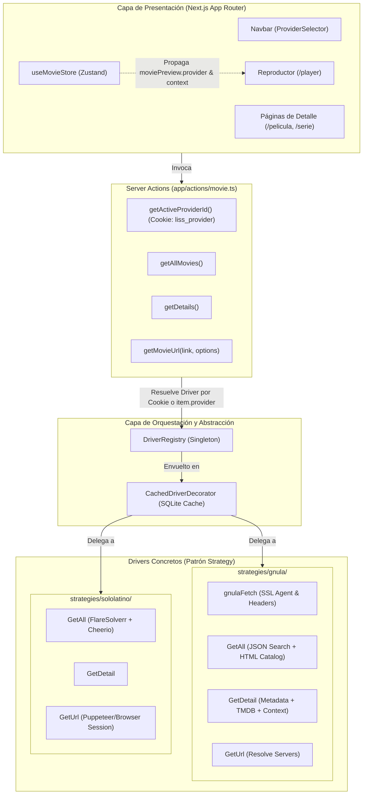
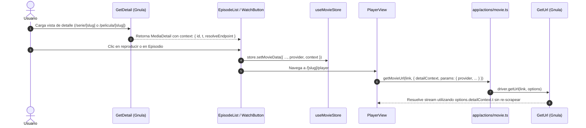

# Especificación Técnica de Arquitectura: Sistema de Drivers y Estrategias

Este documento sirve como referencia arquitectónica y técnica para agentes de IA y desarrolladores que trabajen en este repositorio. Detalla la refactorización arquitectónica realizada para transformar la plataforma en un sistema modular basado en **Drivers/Plugins**, cumpliendo estrictamente con los principios **SOLID**, **Clean Architecture** y las directrices obligatorias de [`AGENTS.md`](./AGENTS.md).

---

## 1. Contexto y Objetivos de la Refactorización

### 1.1 Problemas Anteriores (Deuda Técnica)
- **Acoplamiento de UI a Proveedores Concretos:** La interfaz y las rutas (`/pelicula/[slug]`, `/serie/[slug]`) asumían convenciones específicas de un proveedor único (Solo Latino). Cuando se introdujo Gnula, sus enlaces `/ver/<slug>` provocaban errores 404 o requerían parches y redirecciones a nivel de páginas (`app/ver/[slug]`).
- **Catalogación Errónea de Contenido:** Títulos como *Rick y Morty* se mapeaban como películas en lugar de series, rompiendo la vista de episodios.
- **Violación de Responsabilidad Única (SRP):** Las estrategias de scraping ejecutaban llamadas directas a SQLite (`movie.store`), mezclando persistencia/caché con lógica de scraping web.
- **Incapacidad de Extender Parámetros en Reproducción (`GetUrl`):** `getUrl(path: string)` solo aceptaba una cadena simple, imposibilitando que proveedores con autenticación dinámica (como Gnula con tokens `id` y `t`, o selección de servidor/idioma) pudieran recibir sus parámetros sin volver a descargar el HTML.
- **Resolución Heurística y Frágil:** En [`drivers/registry.ts`](./drivers/registry.ts) existían chequeos frágiles como `if (link.includes("/ver/"))` que violaban Open/Closed (OCP) e Inversión de Dependencias (DIP).

### 1.2 Objetivos Cumplidos
1. **Modularidad Total:** Cada proveedor funciona como un driver/plugin intercambiable y aislado en su propia carpeta (`strategies/<proveedor>`).
2. **Cambio de Proveedor en Tiempo de Ejecución (Runtime Switching):** El usuario puede alternar entre proveedores en cualquier momento desde la barra de navegación; el estado persiste vía cookie HTTP-only (`liss_provider`).
3. **Desacoplamiento de Persistencia con Patrón Decorator:** Las estrategias solo hacen scraping y transformación; la caché de SQLite la gestiona `CachedDriverDecorator`.
4. **Ciclo de Vida de Metadatos (`item.provider` y `context`):** Modelo de dominio tipado y extensible para transportar tokens, servidores y el origen del contenido sin depender de formatos de URL.

---

## 2. Diagrama de Arquitectura



---

## 3. Modelo de Dominio y Segregación de Interfaces (SOLID)

Para cumplir con Interface Segregation (ISP) y Dependency Inversion (DIP), los tipos se modularizaron en `src/types/`:

| Archivo | Responsabilidad |
|---|---|
| [`types/domain.ts`](file:///C:/Users/casti/DEsktop/web/liss-tv/types/domain.ts) | Modelos puros del negocio: `MediaItem`, `MediaDetail`, `Episode`, `Season`, `StreamSource`, `Movies`. Todos admiten `provider?: string` y `context?: Record<string, unknown>`. |
| [`types/driver.ts`](file:///C:/Users/casti/DEsktop/web/liss-tv/types/driver.ts) | Contrato `MovieDriver`, opciones genéricas `GetUrlOptions` y las interfaces de estrategia (`StrategyGetAllMovies`, `StrategyGetMovieDetails`, `StrategyGetUrl`, `MovieBuilder<T>`). |
| [`types/ui.ts`](file:///C:/Users/casti/DEsktop/web/liss-tv/types/ui.ts) | Tipos específicos de vistas y Zustand: `MoviePreview`, `ContinueWatching`, `MovieState`, `EpisodeListProps`. |
| [`types/movie.ts`](file:///C:/Users/casti/DEsktop/web/liss-tv/types/movie.ts) | Facade de re-exportación para preservar 100% de compatibilidad hacia atrás con imports preexistentes. |

### Contrato Principal del Driver

```typescript
export interface MovieDriver {
  readonly id: string;
  readonly name: string;
  getAll(query?: DriverQuery): Promise<Movies | undefined>;
  getDetail(link: string): Promise<Omit<StoredMovie, "link" | "updatedAt"> | undefined>;
  getUrl(path: string, options?: GetUrlOptions): Promise<Url>;
}
```

---

## 4. Patrón Decorator y Persistencia en Caché

Para liberar a las estrategias de scraper de la responsabilidad de gestionar bases de datos, se implementó [`drivers/cached-driver.decorator.ts`](file:///C:/Users/casti/DEsktop/web/liss-tv/drivers/cached-driver.decorator.ts):

- **Transparente:** Implementa `MovieDriver` e intercepta las llamadas a `getAll` y `getDetail`.
- **Namespace Aislado:** Genera claves compuestas en SQLite (ej. `gnula:home:page:1`, `solo-latino:search:batman:page:1`) evitando colisiones entre proveedores.
- **Sellado Automático:** Garantiza que cada película, serie o detalle devuelto por el driver lleve inyectado `provider: this.id` antes de persistirse o entregarse a la aplicación.

---

## 5. Ciclo de Vida de Metadatos y Tokens (`GetUrlOptions`)

Cuando un proveedor necesita tokens de sesión, IDs de servidores o firmas (como los scripts de Gnula que incluyen `&t=...` y `data-id`), el sistema utiliza el **patrón de Contexto Extensible**:



### Opciones de GetUrl

```typescript
export interface GetUrlOptions {
  serverId?: string;                    // Servidor elegido (ej. "1", "streamtape")
  language?: string;                    // Pista de audio ("latino", "castellano", "sub")
  season?: string | number;             // Temporada
  episode?: string | number;            // Episodio
  detailContext?: Record<string, unknown>; // Metadatos extraídos en GetDetail
  params?: Record<string, unknown>;     // Kwargs genéricos (incluye provider)
}
```

---

## 6. Resolución de Drivers y Eliminación de Heurísticas

En [`drivers/registry.ts`](file:///C:/Users/casti/DEsktop/web/liss-tv/drivers/registry.ts) se eliminó cualquier condicional basado en la estructura de URLs (como `if (/ver/)`):

- **Resolución Primaria:** Por identificador explícito de proveedor (`item.provider` o `options.params.provider`).
- **Resolución Secundaria (Fallback):** Si no se provee un ID, se utiliza el proveedor activo configurado por el usuario en la cookie `liss_provider` (o el predeterminado `gnula`).
- **Cero Código Muerto:** El registro no sabe cómo funcionan las URLs de Gnula ni de Solo Latino, respetando el principio Open/Closed.

---

## 7. Detalles del Proveedor Gnula HD (`strategies/gnula/`)

| Archivo | Responsabilidad y Solución Implementada |
|---|---|
| [`client.ts`](file:///C:/Users/casti/DEsktop/web/liss-tv/strategies/gnula/client.ts) | Cliente HTTP unificado con `https.Agent({ rejectUnauthorized: false })` (para resolver cadenas de certificados no reconocidas por Node en el host) y cabeceras estándar. |
| [`get-all.operation.ts`](file:///C:/Users/casti/DEsktop/web/liss-tv/strategies/gnula/get-all.operation.ts) | **Búsqueda:** Consume el endpoint JSON oficial (`/wp-json/gnrd/v1/search?q=`) que clasifica exactamente `type: "Serie"` vs `"Película"`, generando rutas canónicas `/serie/<slug>` o `/pelicula/<slug>`. **Catálogo:** Cheerio HTML parsing con paginación (`a.gnrd-loadmore` y `a.page-numbers`). |
| [`get-detail.operation.ts`](file:///C:/Users/casti/DEsktop/web/liss-tv/strategies/gnula/get-detail.operation.ts) | Extrae sinopsis, géneros, puntuaciones, póster y backdrop de TMDB en resolución original (`/original/`). Agrupa episodios por temporada mediante el patrón `(\d+)x(\d+)` e inyecta los tokens `id` y `t` en `context`. |
| [`builder/gnula.build.ts`](file:///C:/Users/casti/DEsktop/web/liss-tv/builder/gnula.build.ts) | Builder que instancia `MovieContext` con las operaciones de Gnula registrado bajo el ID `"gnula"`. |

---

## 8. Guía para Agregar un Nuevo Proveedor (Paso a Paso)

Para incorporar un nuevo proveedor sin romper nada existente:

1. **Crear la carpeta del proveedor:** `src/strategies/<nombre-proveedor>/`
2. **Crear el cliente HTTP:** `client.ts` con la URL base y headers específicos.
3. **Implementar las operaciones cumpliendo los contratos:**
   - `get-all.operation.ts`: implementa `StrategyGetAllMovies`.
   - `get-detail.operation.ts`: implementa `StrategyGetMovieDetails`.
   - `get-url.operation.ts`: implementa `StrategyGetUrl`.
4. **Crear el Builder:** En `src/builder/<nombre-proveedor>.build.ts` implementando `MovieBuilder<MovieContext>`.
5. **Registrar en la Factory y en el Registry:**
   - En [`builder/factory.ts`](file:///C:/Users/casti/DEsktop/web/liss-tv/builder/factory.ts), agregar el case del nuevo builder.
   - En [`drivers/registry.ts`](file:///C:/Users/casti/DEsktop/web/liss-tv/drivers/registry.ts), registrar la nueva instancia dentro del método `initialize()`.
6. **Listo:** La UI, el selector de proveedores (`ProviderSelector`), la caché SQLite y el reproductor reconocerán automáticamente el nuevo proveedor sin modificar componentes ni páginas.
